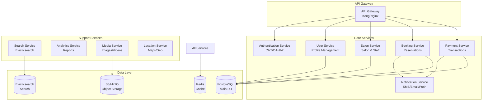

# راهنمای فنی پیاده‌سازی سیستم رزرو نوبت آرایشگاه

## 🏗️ معماری سیستم

### معماری Microservices



## 📊 مدل داده‌ها (Database Schema)

### 1. جداول اصلی

```sql
-- جدول کاربران
CREATE TABLE users (
    id UUID PRIMARY KEY DEFAULT gen_random_uuid(),
    phone_number VARCHAR(15) UNIQUE NOT NULL,
    first_name VARCHAR(100),
    last_name VARCHAR(100),
    email VARCHAR(255),
    password_hash VARCHAR(255),
    avatar_url TEXT,
    role ENUM('customer', 'staff', 'salon_owner', 'admin'),
    is_verified BOOLEAN DEFAULT false,
    is_locked BOOLEAN DEFAULT false,
    created_at TIMESTAMP DEFAULT CURRENT_TIMESTAMP,
    updated_at TIMESTAMP DEFAULT CURRENT_TIMESTAMP
);

-- جدول آرایشگاه‌ها
CREATE TABLE salons (
    id UUID PRIMARY KEY DEFAULT gen_random_uuid(),
    owner_id UUID REFERENCES users(id),
    name VARCHAR(255) NOT NULL,
    slug VARCHAR(255) UNIQUE NOT NULL,
    description TEXT,
    phone_number VARCHAR(15),
    email VARCHAR(255),
    address TEXT,
    latitude DECIMAL(10, 8),
    longitude DECIMAL(11, 8),
    opening_hours JSONB,
    is_active BOOLEAN DEFAULT true,
    verification_status ENUM('pending', 'verified', 'rejected'),
    subscription_plan_id UUID,
    rating_average DECIMAL(3, 2) DEFAULT 0,
    rating_count INTEGER DEFAULT 0,
    created_at TIMESTAMP DEFAULT CURRENT_TIMESTAMP
);

-- جدول آرایشگران
CREATE TABLE staff (
    id UUID PRIMARY KEY DEFAULT gen_random_uuid(),
    user_id UUID REFERENCES users(id),
    salon_id UUID REFERENCES salons(id),
    specializations TEXT[],
    bio TEXT,
    experience_years INTEGER,
    rating_average DECIMAL(3, 2) DEFAULT 0,
    rating_count INTEGER DEFAULT 0,
    is_active BOOLEAN DEFAULT true,
    commission_rate DECIMAL(5, 2),
    created_at TIMESTAMP DEFAULT CURRENT_TIMESTAMP
);

-- جدول خدمات
CREATE TABLE services (
    id UUID PRIMARY KEY DEFAULT gen_random_uuid(),
    salon_id UUID REFERENCES salons(id),
    name VARCHAR(255) NOT NULL,
    description TEXT,
    duration_minutes INTEGER NOT NULL,
    price DECIMAL(10, 2) NOT NULL,
    capacity INTEGER DEFAULT 1,
    category VARCHAR(100),
    is_active BOOLEAN DEFAULT true,
    created_at TIMESTAMP DEFAULT CURRENT_TIMESTAMP
);

-- جدول رزروها
CREATE TABLE bookings (
    id UUID PRIMARY KEY DEFAULT gen_random_uuid(),
    customer_id UUID REFERENCES users(id),
    salon_id UUID REFERENCES salons(id),
    staff_id UUID REFERENCES staff(id),
    service_id UUID REFERENCES services(id),
    booking_date DATE NOT NULL,
    start_time TIME NOT NULL,
    end_time TIME NOT NULL,
    status ENUM('pending', 'confirmed', 'cancelled', 'completed', 'no_show'),
    total_price DECIMAL(10, 2),
    discount_amount DECIMAL(10, 2) DEFAULT 0,
    notes TEXT,
    cancellation_reason TEXT,
    created_at TIMESTAMP DEFAULT CURRENT_TIMESTAMP,
    updated_at TIMESTAMP DEFAULT CURRENT_TIMESTAMP
);

-- جدول پرداخت‌ها
CREATE TABLE payments (
    id UUID PRIMARY KEY DEFAULT gen_random_uuid(),
    booking_id UUID REFERENCES bookings(id),
    amount DECIMAL(10, 2) NOT NULL,
    method ENUM('online', 'pos', 'kiosk', 'cash'),
    status ENUM('pending', 'completed', 'failed', 'refunded'),
    transaction_id VARCHAR(255),
    gateway_response JSONB,
    created_at TIMESTAMP DEFAULT CURRENT_TIMESTAMP
);

-- جدول امتیازات و نظرات
CREATE TABLE reviews (
    id UUID PRIMARY KEY DEFAULT gen_random_uuid(),
    customer_id UUID REFERENCES users(id),
    salon_id UUID REFERENCES salons(id),
    staff_id UUID REFERENCES staff(id),
    booking_id UUID REFERENCES bookings(id),
    rating INTEGER CHECK (rating >= 1 AND rating <= 5),
    comment TEXT,
    is_verified BOOLEAN DEFAULT false,
    created_at TIMESTAMP DEFAULT CURRENT_TIMESTAMP
);

-- جدول علاقه‌مندی‌ها
CREATE TABLE favorites (
    id UUID PRIMARY KEY DEFAULT gen_random_uuid(),
    user_id UUID REFERENCES users(id),
    salon_id UUID REFERENCES salons(id),
    staff_id UUID REFERENCES staff(id),
    created_at TIMESTAMP DEFAULT CURRENT_TIMESTAMP,
    UNIQUE(user_id, salon_id, staff_id)
);
```

## 🔐 سیستم احراز هویت

### JWT Token Structure

```javascript
// Token Payload
{
  "sub": "user_uuid",
  "role": "customer",
  "iat": 1234567890,
  "exp": 1234567890,
  "permissions": ["booking:create", "profile:edit"]
}
```

### Authentication Flow

```typescript
// Authentication Service
export class AuthService {
  async register(phoneNumber: string): Promise<void> {
    // 1. Check if user exists
    // 2. Generate OTP
    // 3. Send SMS
    // 4. Store OTP in Redis with TTL
  }

  async verifyOTP(phoneNumber: string, otp: string): Promise<TokenPair> {
    // 1. Verify OTP from Redis
    // 2. Create/Update user
    // 3. Generate JWT tokens
    // 4. Return access & refresh tokens
  }

  async refreshToken(refreshToken: string): Promise<TokenPair> {
    // 1. Verify refresh token
    // 2. Generate new token pair
    // 3. Invalidate old refresh token
  }
}
```

## 📱 API Endpoints

### Core API Structure

```yaml
# Authentication APIs
POST   /api/v1/auth/register
POST   /api/v1/auth/verify-otp
POST   /api/v1/auth/refresh
POST   /api/v1/auth/logout

# User Management
GET    /api/v1/users/profile
PUT    /api/v1/users/profile
POST   /api/v1/users/upload-documents
GET    /api/v1/users/favorites
POST   /api/v1/users/favorites

# Salon Management
GET    /api/v1/salons
GET    /api/v1/salons/:id
POST   /api/v1/salons
PUT    /api/v1/salons/:id
GET    /api/v1/salons/:id/staff
GET    /api/v1/salons/:id/services
GET    /api/v1/salons/:id/reviews

# Booking Management
POST   /api/v1/bookings
GET    /api/v1/bookings/:id
PUT    /api/v1/bookings/:id/status
GET    /api/v1/bookings/availability
GET    /api/v1/bookings/my-bookings

# Payment Processing
POST   /api/v1/payments/initiate
POST   /api/v1/payments/verify
GET    /api/v1/payments/history
```

## 🎨 Frontend Architecture

### Tech Stack

```javascript
// Frontend Dependencies
{
  "dependencies": {
    // Core
    "react": "^18.2.0",
    "next": "^14.0.0",
    "typescript": "^5.0.0",
    
    // State Management
    "@reduxjs/toolkit": "^1.9.0",
    "react-redux": "^8.0.0",
    
    // UI Framework
    "@mui/material": "^5.14.0",
    "@emotion/react": "^11.11.0",
    
    // Maps
    "react-map-gl": "^7.1.0",
    "mapbox-gl": "^2.15.0",
    
    // Forms
    "react-hook-form": "^7.45.0",
    "yup": "^1.2.0",
    
    // API
    "axios": "^1.5.0",
    "@tanstack/react-query": "^4.32.0",
    
    // PWA
    "next-pwa": "^5.6.0",
    "workbox-webpack-plugin": "^7.0.0"
  }
}
```

### Component Structure

```
src/
├── components/
│   ├── common/
│   │   ├── Header.tsx
│   │   ├── Footer.tsx
│   │   └── Loading.tsx
│   ├── auth/
│   │   ├── LoginForm.tsx
│   │   └── OTPVerification.tsx
│   ├── salon/
│   │   ├── SalonCard.tsx
│   │   ├── SalonDetail.tsx
│   │   └── ServiceList.tsx
│   └── booking/
│       ├── BookingCalendar.tsx
│       ├── TimeSlotPicker.tsx
│       └── BookingSummary.tsx
├── pages/
│   ├── index.tsx
│   ├── salons/
│   │   ├── index.tsx
│   │   └── [id].tsx
│   └── dashboard/
│       ├── customer.tsx
│       ├── salon.tsx
│       └── admin.tsx
├── services/
│   ├── api.ts
│   ├── auth.service.ts
│   └── booking.service.ts
└── store/
    ├── index.ts
    ├── auth.slice.ts
    └── booking.slice.ts
```

## 🚀 DevOps & Deployment

### Docker Configuration

```dockerfile
# Backend Dockerfile
FROM node:18-alpine AS builder
WORKDIR /app
COPY package*.json ./
RUN npm ci --only=production

FROM node:18-alpine
WORKDIR /app
COPY --from=builder /app/node_modules ./node_modules
COPY . .
EXPOSE 3000
CMD ["node", "dist/main.js"]
```

### Kubernetes Deployment

```yaml
apiVersion: apps/v1
kind: Deployment
metadata:
  name: booking-api
spec:
  replicas: 3
  selector:
    matchLabels:
      app: booking-api
  template:
    metadata:
      labels:
        app: booking-api
    spec:
      containers:
      - name: api
        image: salon-booking/api:latest
        ports:
        - containerPort: 3000
        env:
        - name: DATABASE_URL
          valueFrom:
            secretKeyRef:
              name: db-secret
              key: url
        resources:
          requests:
            memory: "256Mi"
            cpu: "250m"
          limits:
            memory: "512Mi"
            cpu: "500m"
```

## 🔍 Monitoring & Logging

### ELK Stack Setup

```yaml
# docker-compose.yml
version: '3.8'
services:
  elasticsearch:
    image: elasticsearch:8.10.0
    environment:
      - discovery.type=single-node
      - ES_JAVA_OPTS=-Xms512m -Xmx512m
    ports:
      - "9200:9200"
  
  logstash:
    image: logstash:8.10.0
    volumes:
      - ./logstash/pipeline:/usr/share/logstash/pipeline
    depends_on:
      - elasticsearch
  
  kibana:
    image: kibana:8.10.0
    ports:
      - "5601:5601"
    depends_on:
      - elasticsearch
```

### Monitoring with Prometheus & Grafana

```yaml
# prometheus.yml
global:
  scrape_interval: 15s

scrape_configs:
  - job_name: 'booking-api'
    static_configs:
      - targets: ['api:3000']
    metrics_path: '/metrics'
```

## 🔒 Security Best Practices

### 1. API Security
- Rate limiting with Redis
- CORS configuration
- Helmet.js for security headers
- Input validation & sanitization

### 2. Data Protection
- Encryption at rest (AES-256)
- Encryption in transit (TLS 1.3)
- PII data masking in logs
- Regular security audits

### 3. Infrastructure Security
- Network policies in Kubernetes
- Secret management with HashiCorp Vault
- Regular dependency updates
- WAF implementation

## 📈 Performance Optimization

### 1. Caching Strategy
```javascript
// Redis Caching
const cacheKey = `salon:${salonId}`;
const cachedData = await redis.get(cacheKey);
if (cachedData) {
  return JSON.parse(cachedData);
}
const data = await db.salon.findById(salonId);
await redis.setex(cacheKey, 3600, JSON.stringify(data));
```

### 2. Database Optimization
- Proper indexing
- Query optimization
- Connection pooling
- Read replicas for reporting

### 3. CDN Configuration
- Static assets on CDN
- Image optimization with WebP
- Lazy loading implementation
- Browser caching headers

## 🧪 Testing Strategy

### Unit Tests
```javascript
describe('BookingService', () => {
  it('should create booking successfully', async () => {
    const booking = await bookingService.create({
      customerId: 'uuid',
      salonId: 'uuid',
      serviceId: 'uuid',
      date: '2024-01-01',
      time: '10:00'
    });
    expect(booking).toBeDefined();
    expect(booking.status).toBe('pending');
  });
});
```

### Integration Tests
```javascript
describe('Booking API', () => {
  it('POST /api/v1/bookings', async () => {
    const response = await request(app)
      .post('/api/v1/bookings')
      .set('Authorization', `Bearer ${token}`)
      .send(bookingData);
    
    expect(response.status).toBe(201);
    expect(response.body.booking).toBeDefined();
  });
});
```

### E2E Tests with Cypress
```javascript
describe('Booking Flow', () => {
  it('should complete booking process', () => {
    cy.visit('/salons');
    cy.get('[data-testid="salon-card"]').first().click();
    cy.get('[data-testid="book-now"]').click();
    cy.get('[data-testid="time-slot"]').first().click();
    cy.get('[data-testid="confirm-booking"]').click();
    cy.url().should('include', '/booking/success');
  });
});
```

## 🔄 CI/CD Pipeline

### GitLab CI Configuration
```yaml
stages:
  - test
  - build
  - deploy

test:
  stage: test
  script:
    - npm install
    - npm run test
    - npm run lint

build:
  stage: build
  script:
    - docker build -t $CI_REGISTRY_IMAGE:$CI_COMMIT_SHA .
    - docker push $CI_REGISTRY_IMAGE:$CI_COMMIT_SHA

deploy:
  stage: deploy
  script:
    - kubectl set image deployment/api api=$CI_REGISTRY_IMAGE:$CI_COMMIT_SHA
  only:
    - main
```

این راهنمای فنی، پایه‌ای قوی برای پیاده‌سازی سیستم رزرو نوبت آرایشگاه فراهم می‌کند و می‌تواند بر اساس نیازهای خاص پروژه تنظیم شود.